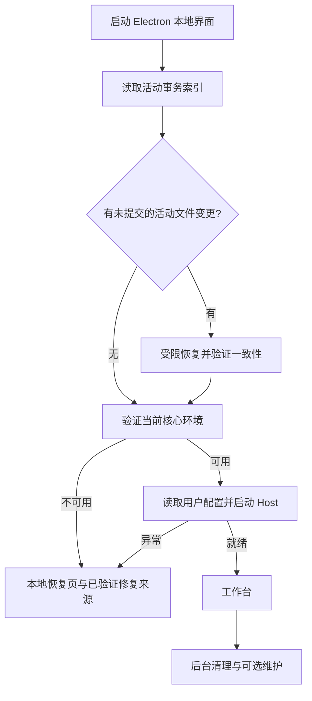

# Windows 安装、备份恢复与启动可靠性整改方案

审查日期：2026-11-06。审查基线：`main`，父提交 `e7003c6bfcca739aa7ce3b2457c5c5af5d6ea00a`；桌面 8.4.25；DSH `fdf67a9e4d74c1b4b9db33e33231eb488f27cdb6`。

## 结论与证据边界

备份、恢复、提交后清理与启动存在实际耦合，足以让本可使用的安装或 profile 被维护错误阻断。整改重点应当是事务状态和启动依赖，而不是继续扩大重试次数。

以下前三项已通过隔离实验复现，使用的目录全部在 `artifacts/verification/8.4.25/install-failure-20261106/`，没有操作用户真实安装。它们证明当前代码有缺陷，但不能据此认定两台故障电脑分别命中了哪一项。第一台缺少事务详细错误；第二台提供的是 startup 摘要，还没有实际 harness.log 内容。

| 发现 | 代码位置 | 结果 |
| --- | --- | --- |
| 已提交安装仍被旧备份清理阻断 | `tools/commands/installer-copy-files.mjs` 的 `finishCleanup` 与恢复分支 | 首次安装返回 0，journal 为 committed；用真正的 Windows 文件共享锁占用 backup/app.exe 后，再次安装返回 1 / INSTALLER_RECOVERY_CLEANUP_PENDING，目标应用文件已经正确安装 |
| 已接受事务仍可执行失败回滚 | `tools/commands/profile-pnpm-transaction.mjs` 的 `beginDirectProfilePackageChange().finish`；`resource-manager.mjs` 多个调用方的提交后 catch | `finish(true)` 后插件为 2.0.0、配置为 new；再执行 `finish(false)` 后配置变 old，插件仍为 2.0.0，before 备份已经删除。形成新旧混合环境 |
| 单个损坏历史 journal 阻断全部恢复 | `profile-pnpm-transaction.mjs` 的 `recoverPnpmTransactions` | 初始化时 Promise.all 解析所有 UUID 历史记录，任一 JSON 截断就抛出 SyntaxError，尚未判断活动环境是否可用 |
| 配置初始化先于事务恢复 | `desktop/src/main/index.ts` 的 `initializeProfile`、`resources.recover` | 先读写活动配置，再尝试恢复上次未完成写入；中断造成的配置问题有机会在恢复开始前终止启动 |
| 提交决定、删除备份和外围记账次序混杂 | `resource-manager.mjs` 的 `repairOfflineDirect`、`activatePackages`、`setPluginEnabledDirect` 等 | 先 finish(true) 清理 before，之后删除标记/写外围 journal；后续错误又进入 finish(false)。旧整体 profile 分支也在删除 backup 后才记录最终状态 |
| 旧整体恢复未先证明备份完整 | `resource-manager.mjs` 的旧 `activate` / `recover` 分支 | 递归清理 backup 可能部分完成才报错；异常分支仍可能删除当前 active 并恢复这份残缺 backup。恢复路径的 exists 仅检查 package.json，不能证明完整性。这项为代码审查风险，尚未单独做故障注入复现 |
| 非核心元数据仍在主启动链上 | `desktop/src/main/index.ts` 的 Python shim 准备、pending 列表读取；`profile-pending.mjs` | shim 文件异常、待办记录损坏或读取失败可使主启动链抛错 |
| 本地修复供给可能已被清理 | `desktop/src/main/index.ts` 的 startupProfile / cleanupOffline | 活动插件稍后损坏，而供给已经清理时，目前直接要求重装，缺少独立可用的本地恢复入口 |
| Host 异步异常会被吞为 exit 0 | `desktop/build/harness-node-entry.mjs` | 修复前：异步 throw 或未处理 rejection 只记录错误，不设置失败状态，不发送失败 IPC；复现实验得到 exit 0 |

原始复现结果为 `recovery-audit-result.json`、`host-before.json` 和 `native-reproduction.json`。安装事务退出 1 不是端口错误证据；安装复制助手不启动 Host 的 HTTP 服务。NSIS nsExec 默认没有执行超时，本次已排除此猜测。

## 整改后的行为合同

1. 清理旧备份、删除候选、写辅助记录、导出诊断失败，只产生“维护待处理”，不得把已经提交并验证的安装改为失败。
2. 未提交且改动了活动文件的事务必须恢复一致性。恢复本身失败时，保留原始证据，提供独立恢复界面，不加载混合或未验证的运行文件。
3. 已提交状态不可逆。回滚只能针对尚未提交的事务；对已提交事务的重复 finish(false) 不得修改任何文件。
4. 活动环境只允许完整旧代或完整新代。包文件、依赖、manifest、用户选择与物化收据必须属于同一决定。
5. 桌面本地恢复页独立于 DSH、插件、Python 和旧数据迁移。Host 不能启动时仍能查看错误、导出日志、重试及使用已验证的恢复来源。
6. 保留用户账号、模型、协议、参数、项目、聊天、导入资源、禁用与固定版本；不能通过重置 profile 或换模型换取“启动成功”。Python 继续使用原固定根，不引入 Python 版本槽或旧槽迁移。
7. 签名、路径边界、文件摘要与受影响插件的健康检查继续保留。系统拒绝写入、载荷损坏或无可验证运行环境时，不伪报成功；应在改动活动版本前失败，或进入可操作恢复页。

## 第一阶段：修正事务边界

### 安装事务

- 将固定 stage/backup 拆为独立事务 ID 的目录，并保存小型活动事务索引。已提交旧事务的清理不占用新事务的目录，也不成为重装前置条件。
- 兼容读取 8.4.25 及更早的 schema 1 journal。staging/applying 执行必要恢复；committed/rolled-back 只进入有所有权约束的清理队列。旧备份被锁时保留它，继续新的事务。
- 先清空事务所属的临时文件和子目录，最后移除权威 journal。当前先删除 journal、再删除子目录的顺序会扩大中断后的不确定性。
- 恢复时校验安装根、事务 ID、状态和每条拥有路径；补充恢复所需文件身份，避免将其他事务或用户文件当备份。
- 安装提交前，继续完成载荷签名/摘要、暂存、ACL、空间和目标可写检查。首次安装只创建候选，不删除未知文件；覆盖安装在新代就绪前保留旧代。
- 保留实际错误、当前阶段、文件进度和子进程退出状态；进程被外部结束时，最后检查点应明确标记“中断”，而非推断“载荷损坏”。

### 插件与 profile 事务

- 收敛为一个权威提交决定；外围资源 journal 是索引，不得与包级 journal 各自决定是否回滚。
- 顺序统一为：准备候选 → 校验 → 必要的 Host 停止 → 受影响路径发布 → Host/受影响插件验收 → 持久提交决定 → 返回成功 → 异步清理。
- `finish(true)` 的提交必须先于备份删除；`finish(false)` 检查权威状态，对 committed 只返回“已经提交”。重复恢复、重启恢复和清理都必须幂等。
- 提交后的 unlink、候选清理、日志写入、锁释放或辅助状态保存失败，分别记为维护事项，禁止再进入回滚分支。
- 未提交事务回滚失败时同时保存 primaryError 与 rollbackError，不用第二个错误覆盖最初原因。
- 兼容旧整体 profile 时，先验证备份完整性和版本一致性，再决定恢复；保留已验证候选，不先删除唯一可用环境。部分清理过的备份不能再作为可运行回滚来源。
- 成功更新不保存长期完整 profile 回滚副本。事务备份仅保留到验收提交；本地修复种子与用户主动安装旧版承担后续恢复，不扩大备份增长。

## 第二阶段：缩短并隔离启动依赖

建议顺序：

- 在任何配置初始化/迁移写操作之前，先处理会影响该配置的未提交事务。历史归档不再全量参与普通启动。
- 不能直接忽略坏 journal。先检查活动文件是否完整、是否存在未提交变更，再隔离无关旧记录；无法证明一致性时进入恢复页，保留备份。
- 旧数据恢复分阶段：账号/模型等必要配置保持事务和优先级；大批聊天附件与历史维护有独立进度、可续做且不占用 Host 启动。尚未恢复的配置不得用默认模型代替。
- Python、MCP、目录检查、任务列表和清理失败，仅影响其功能状态。Python shim 不可用时要继续禁止误用系统 Python，但桌面设置与恢复页仍可打开。
- Host 端口默认让服务自己绑定 0；需要保持历史 origin 时优先旧端口，明确的占用/拒绝后只进行一次系统分配端口恢复。实际端口与错误写日志；不强杀其他软件、不无限重启。
- 插件故障必须定位到模块。可选插件仅在本次恢复会话隔离，不悄悄改写永久禁用、固定版本、第三方插件或用户参数；核心不可验证时使用恢复页。
- 保留签名且兼容当前桌面/DSH 的最小核心修复种子。清理离线供给前，证明另有可用的本地恢复来源；资源更新仍遵守用户明确操作要求，不在启动时偷偷联网重装插件。

## 第三阶段：按故障注入验收后才打包

| 故障 | 必须达到的验收结果 |
| --- | --- |
| 旧 committed 备份被真实 Windows 共享锁占用 | 当前安装可用；新安装不被旧清理阻断；清理保持 pending |
| 提交之后删除标记、写外围 journal 或释放锁失败 | 活动版本不回退，不产生新旧混用；报告维护待处理 |
| 任意阶段强制结束安装器/Host | 下次启动幂等恢复；只出现完整旧代或完整新代；不丢用户内容 |
| 单份旧日志损坏、截断、缺失 | 不阻断已验证活动核心；未知活动状态进入恢复页，保留证据 |
| 两次重试、重复调用 finish、重复恢复 | 不重复删除或回滚已提交文件，不清理其他事务 |
| 端口占用、Windows 保留端口、异步 bind 错误 | 一次端口恢复；失败原因准确；本地恢复页可使用 |
| 可选插件抛错、旧配置不兼容、供给已清理 | 不重置用户设置；有模块定位和签名恢复路径 |
| Python 未就绪、联网失败、MCP 不可用、清理失败 | 主桌面可用，对应功能显示可恢复状态 |
| 中文/空格/长路径、C/D 跨盘、当前用户/UAC | 全文件摘要匹配、CLI 可运行、范围与用户身份正确 |
| 磁盘不足、永久 ACL 拒绝、被安全软件终止 | 不伪造成功；原安装/用户数据保留，错误与最后检查点可导出 |

每一项测试必须检查实际文件、配置、进程与界面结果，不能只断言退出码。验收包括干净安装、8.4.25 覆盖升级、已有残留事务升级、首次启动、二次启动和两台故障电脑的真实回归。先验证小范围修复，再执行仓库规定检查与最终安装器/ASAR/DSH/ZWS/manifest/SHA-256 验收。

## 8.4.26 实施状态

以上问题表记录的是 8.4.25 审计基线。8.4.26 已实现以下整改，实际交付结果和产物身份记录在 `artifacts/verification/8.4.26/delivery-report.md`。

- 安装采用 schema 2 独立 UUID 事务目录；兼容旧 schema 1 恢复。已提交备份清理失败不阻断新安装，journal 最后删除。恢复校验安装根、拥有路径及前后文件大小/摘要。
- 插件包级 journal 成为权威提交决定；已提交事务的失败回调不能回滚文件或声明。提交后辅助收据、候选清理和锁释放失败仅记录待维护。旧整体 profile 恢复先验证备份，再通过重命名切换，保留原活动目录。
- 启动先恢复事务，再迁移必要用户配置和初始化 profile。已验证健康的 profile 使用只读启动检查，不重写未变化声明；损坏历史记录只能在证明活动环境一致后隔离。
- Windows 候选文件通过独立临时文件复制；原生 CopyFile 权限错误可退回普通字节读写，有限重试，不修改源文件、用户文件或共享依赖的 ACL。永久读写拒绝仍保留明确错误和恢复证据。
- 账户与模型配置先恢复，聊天和附件历史在工作台就绪后续传；独立完成收据防止再次覆盖用户后来修改的配置。Python shim 维护失败可使用安装内逐字节验证的只读供给，禁止改用系统 Python。
- 保留安装器携带的签名 `offline-profile` 作为本地修复来源，不再在桌面就绪后删除唯一供给；不增加另一份完整 profile 备份。
- 本地启动失败页不依赖 Host，提供重试、本地修复、诊断导出、打开日志和退出。配置恢复尚未完成时明确保留原数据并提示重试/覆盖安装；不会将未验证的配置强行初始化成默认值。
- Host 异步致命异常通过 IPC 回传并非零退出；端口恢复仅限启动期间一次；activation 错误保留真实原因。安装助手与 NSIS 保留阶段、当前文件及中断检查点。

## 验证范围与限制

已完成真实 Windows 共享锁、ACL 拒绝、CopyFile EPERM、只读部分文件、安装中断重试、重复提交恢复、损坏历史 journal、提交后辅助收据被锁等故障注入。验收同时检查活动文件、用户/Python 哨兵和原始错误；具体命令、数量及正式安装/GUI 验收见交付报告。

全量 `plugins:test` 的 research CSR/CSC 两项在原 5000 ms 限制下超时；该文件单独重跑 11 项全部通过。未修改超时、模型、参数或断言，不能把全量运行描述为全部通过。插件源码及归档格式未改，复用 40 个不可变共享包和 281 个已验证 Skills，不重新发布插件版本。

尚未对两台远端故障电脑直接验收，现有摘要不足以确认它们各自的唯一根因。任意第三方/可选插件的会话隔离尚未新增；不可验证核心继续进入本地恢复页。未覆盖全部断电时点、永久系统/安全软件拦截、真实 UAC 全用户安装和全部硬件环境。这些情形不能承诺无条件安装成功。

8.4.26 使用新 build ID `1793941260821-7bfbf5ac`，已发布的 8.4.25 字节保持不变。打包验收后按用户授权发布七牛和 GitHub，复用该安装包；公开下载、摘要与源码提交的对应关系记录在 `artifacts/verification/8.4.26/publication-report.md`。原始审计证据已保留于 `artifacts/verification/8.4.26/previous-diagnostics/`。
