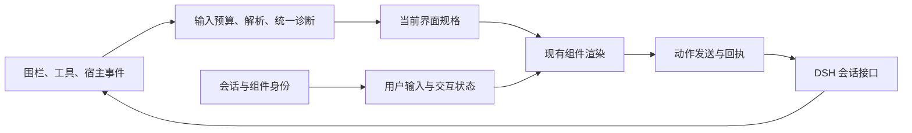

# GenUI 升级研究与重构建议

> 2026-09-08。结论：建议分层重构，保留现有组件与 React 渲染体系。研究已完成；业务代码、日常安装、版本与发布均未变更。

## 一、先给判断

**能升级，而且值得认真做。下一轮应先把“填写不丢、操作有回执、宿主升级可验证”做好。** 现有 45 种组件、表格排序、本地判题、绘图与按需加载已经有基础；直接推倒会重新承担这些能力的实现和验证成本。

重构必要性：**高**。全量换栈必要性：**目前没有证据支持**。这里的重构指收紧输入、状态、宿主接口和错误处理的职责，不能以拆文件数量作为成果。

最重要的发现是：**主分支现有单元测试 494 项通过，但接上当前宿主后仍可复现差异对比崩溃；生成中的输入保存也有实际缺陷。** 因此，单纯增加组件、换样式或继续扩展兼容分支，都不会优先解决核心体验问题。

## 二、研究基线与证据边界

| 项目 | 本次核实结果 |
|---|---|
| 日常源码目录 | `/Users/changfenhuang/projects/dsh-genui`，开始时工作区干净 |
| 本机分支 | `codex/preview-0.9.9`，提交 `16f9015`，包版本 `0.9.9-preview.1` |
| 线上主分支 | 提交 `a1d7b9d8019efc4d6bec8cadd92d5b76ee504825`，与本机分支分叉；主分支侧多 18 次提交，本机侧多 1 次预览版提交 |
| 本机宿主 | 源码当前链接指向 `dsh-v0.1.3-alpha.1`；日常配置通过 `link:` 引用本仓库 |
| 主分支检查 | 临时目录下载固定提交，复用本机已安装依赖；原配置类型检查通过，单元测试 **494 通过 / 0 失败 / 105 跳过**，共 599 项 |
| 预览版检查 | 原配置类型检查通过，单元测试 **453 通过 / 0 失败 / 104 跳过**，共 557 项 |
| 当前宿主接口检查 | 仅将基础组件类型指向当前宿主真实声明，出现 **4 处类型错误** |
| 浏览器验证 | 后台独立页面直接使用主分支组件源码及当前宿主基础组件；复现流式输入清空、清空默认值后恢复、差异对比崩溃；排序与本地判题正常 |
| 未覆盖 | 日常完整 DSH 的模型往返、Windows 原环境、长会话滚动帧率、真实冷启动网络性能；隔离页面结果不等于已完成完整宿主验收 |

普通测试沿用锁定的旧版宿主依赖 `0.1.0-rc.8`，不是实际运行中的 `0.1.3-alpha.1`。当前自动检查虽然克隆并构建指定宿主，但类型配置与测试配置没有据此切换基础组件依赖；浏览器冒烟在“插件激活”之后就退出，没有渲染差异对比等组件。105 项跳过也不能计为通过。参见[依赖与命令定义](https://github.com/omdsh-dev/dsh-genui/blob/a1d7b9d8019efc4d6bec8cadd92d5b76ee504825/package.json)、[测试配置](https://github.com/omdsh-dev/dsh-genui/blob/a1d7b9d8019efc4d6bec8cadd92d5b76ee504825/vitest.config.ts)、[自动检查流程](https://github.com/omdsh-dev/dsh-genui/blob/a1d7b9d8019efc4d6bec8cadd92d5b76ee504825/.github/workflows/ci.yml)、[冒烟退出点](https://github.com/omdsh-dev/dsh-genui/blob/a1d7b9d8019efc4d6bec8cadd92d5b76ee504825/scripts/e2e.mjs#L220)。

开始检查时日常 3080 端口有监听，随后浏览器访问失败且重新检查已无监听。本次没有更改或重启日常服务；组件行为在独立 3198 验证页确认，未将日常服务状态归因于 GenUI。

## 三、已经做好的部分，继续沿用

主分支已经合入统一组件校验（#106）、基础模块提取（#107）、校验职责拆分（#108）、单行输入持久值优先级修复（#110）、原生颜色输入与复选分组（#111、#112）。不能把这些再列成“从零建设”的升级内容。[当前主分支](https://github.com/omdsh-dev/dsh-genui/commit/a1d7b9d8019efc4d6bec8cadd92d5b76ee504825)

对 #102 原始卡片别名样本，当前处理结果保留了标题和正文，并返回别名告警；缺少必需内容的卡片也会返回字段错误。因此“校验完全没接线”已不是主分支现状。现有本地交互、输入法保护、资源上限、错误隔离和面板操作去重也应继续利用，逐项验证实际边界。[当前处理管线](https://github.com/omdsh-dev/dsh-genui/blob/a1d7b9d8019efc4d6bec8cadd92d5b76ee504825/src/client/guard.ts#L1387)

## 四、已确认的问题及其影响

### 1. 宿主接口变了，当前测试没有拦住——第一优先级

插件调用宿主差异对比组件时只传数据；当前宿主还要求复制、展开等按钮文案。隔离浏览器点击最小差异对比样本后，真实报错为 `Cannot read properties of undefined (reading 'copy')`，与公开 #113 报告一致。该报告的 Windows / `0.1.2-rc.1` 组合尚未在本机复测，本次确认的是相同原因在 `0.1.3-alpha.1` 上成立。[插件调用](https://github.com/omdsh-dev/dsh-genui/blob/a1d7b9d8019efc4d6bec8cadd92d5b76ee504825/src/client/blocks/advanced.tsx#L91) · [宿主必需参数](https://github.com/deepseek-ai/deepseek-harness/blob/dsh-v0.1.3-alpha.1/packages/client/ui-primitives/src/DiffBlock.tsx#L23) · [问题报告 #113](https://github.com/omdsh-dev/dsh-genui/issues/113)

真实类型检查还发现 JSON 树缺少 `label/labels`，两处代码块缺少 `copyLabel/copiedLabel`。后面三处是**接口错误已确认**，本次没有声称全部都会以同一种方式崩溃。

最小修法是让现有调用符合当前宿主正式接口，并让测试消费所承诺宿主的真实类型与组件。无需自写一套差异渲染器，也无需改 DSH 本体。

### 2. 模型继续生成时，用户输入被清空——第一优先级

复现步骤：先输出一个完整输入节点，保留围栏未结束；在已出现的输入框填写“用户已填写”；随后追加一个完整文本节点。**原输入框立即变空**。单元复现和真实浏览器结果一致。

原因是围栏入口在有会话 ID 时，即使还没有最终来源身份，也把当前整份内容的指纹写进状态键。新增节点改变指纹，内部组件按新键重新挂载，用户刚输入的状态随旧实例丢失。组件自身已有“无持久键时保留流式实例”的测试，但它没有覆盖真正的围栏入口。[围栏入口](https://github.com/omdsh-dev/dsh-genui/blob/a1d7b9d8019efc4d6bec8cadd92d5b76ee504825/src/client/fence-render.tsx#L182) · [组件身份与重新挂载](https://github.com/omdsh-dev/dsh-genui/blob/a1d7b9d8019efc4d6bec8cadd92d5b76ee504825/src/client/GenuiBlock.tsx#L207)

修复时必须一起验证“继续生成”和“生成结束”两个转换，不能只把持久键暂时去掉，最后完成时再清空一次。短期保持同一块的输入生命周期；后续只有在确有局部更新需求时，才给稳定界面和节点身份增加明确语义。

### 3. “用户清空了”与“用户没填过”混成同一种状态——第一优先级

给输入框一个模型默认值，用户用键盘删除全部内容，等持久化完成后重新挂载同一块，**默认值重新出现**。浏览器先读到空字符串，再读到恢复后的默认值，排除了“其实没有删除成功”。

原因是共享字段仓库删除了空字符串；重新挂载时找不到保存值，就重新采用模型默认值。这说明显示状态与提交收集不能共用“只保留非空字段”的语义：保存时应区分“未设置”和“明确清空”，提交时仍可按现有规则过滤空白。[字段删除逻辑](https://github.com/omdsh-dev/dsh-genui/blob/a1d7b9d8019efc4d6bec8cadd92d5b76ee504825/src/client/GenuiBlock.tsx#L111) · [默认值恢复逻辑](https://github.com/omdsh-dev/dsh-genui/blob/a1d7b9d8019efc4d6bec8cadd92d5b76ee504825/src/client/blocks/forms.tsx#L412)

同文件的多行输入仍把模型默认值放在持久值之前，属于应沿同一规则检查的相邻路径；本次浏览器重点复测的是单行输入的清空行为。

### 4. 新处理管线的前置遍历绕过了资源保护——第一优先级

项目声明最多 8 层嵌套，但新的字段规范化先递归走完整树，之后才做有上限的修复和验证。直接调用主分支处理函数：10 层输入正常返回深度错误；**2,000 层输入抛出调用栈溢出异常**。这不是正常样本的性能测量，而是异常输入边界验证。[规范化递归](https://github.com/omdsh-dev/dsh-genui/blob/a1d7b9d8019efc4d6bec8cadd92d5b76ee504825/src/client/genui-runtime/normalize.ts#L40) · [处理顺序](https://github.com/omdsh-dev/dsh-genui/blob/a1d7b9d8019efc4d6bec8cadd92d5b76ee504825/src/client/guard.ts#L1387)

资源预算需要从第一个接触不可信输入的遍历开始生效，并覆盖字段诊断；不要在各个调用方分别补异常吞掉逻辑。

### 5. 点击后的回执没有完整传回组件——第二优先级

动作回调只返回 `void`，按钮显示 1.4 秒的“已触发”；内联动作发送失败后被空处理，面板动作只写控制台。**现有“已触发”文案没有声称业务成功，但用户也看不到这个动作的发送失败和后续结果。**[回调类型](https://github.com/omdsh-dev/dsh-genui/blob/a1d7b9d8019efc4d6bec8cadd92d5b76ee504825/src/client/action-context.ts#L22) · [发送路径](https://github.com/omdsh-dev/dsh-genui/blob/a1d7b9d8019efc4d6bec8cadd92d5b76ee504825/src/client/index.tsx#L113) · [本地点击提示](https://github.com/omdsh-dev/dsh-genui/blob/a1d7b9d8019efc4d6bec8cadd92d5b76ee504825/src/client/blocks/basic.tsx#L37)

当前宿主发送接口能返回接收失败，但内部是把提示词排入队列，返回成功不能当成业务完成。第一步可直接把这个真实结果传回按钮，显示发送中、已发送或发送失败；进一步显示执行成功，需要把动作与相应回合、工具结果关联。不能凭计时器或“出现了一条新回答”猜成功。[宿主发送实现](https://github.com/deepseek-ai/deepseek-harness/blob/dsh-v0.1.3-alpha.1/packages/client/ui-conversation/src/client/service.ts#L208)

### 6. 组件目录已建立，但还没有成为唯一事实来源——第二优先级

主分支已建立 45 类组件的运行时字段表；类型定义、修复分支、验证分支、模型说明仍有各自的声明。守卫文件由本机基线的 1,562 行变成主分支 1,707 行，同时新建了基础模块。行数本身不代表质量，但证明不能把“已经拆文件”当成“重复规则已经消除”。[组件目录](https://github.com/omdsh-dev/dsh-genui/blob/a1d7b9d8019efc4d6bec8cadd92d5b76ee504825/src/client/genui-runtime/schema.ts#L228) · [模型说明](https://github.com/omdsh-dev/dsh-genui/blob/a1d7b9d8019efc4d6bec8cadd92d5b76ee504825/src/plugin/index.ts#L95)

另一个边界样本是未注册类型 `not-a-real-widget`：处理函数返回零错误、零告警并计为 1 个组件；当前宿主又没有插件所探测的自定义组件注册入口，渲染分发会返回空。这个行为应在能力确认边界解决，不能只看修复后的节点计数就宣称可显示。[未知类型处理](https://github.com/omdsh-dev/dsh-genui/blob/a1d7b9d8019efc4d6bec8cadd92d5b76ee504825/src/client/guard.ts#L1394) · [渲染分发](https://github.com/omdsh-dev/dsh-genui/blob/a1d7b9d8019efc4d6bec8cadd92d5b76ee504825/src/client/blocks/render-node.tsx)

## 五、性能：已有一些数字，但不能夸大

| 检查 | 结果 | 能说明什么 |
|---|---|---|
| 主分支处理 20 个普通文本节点，100 次采样 | 中位约 0.09 ms，95 分位约 1.37 ms | 这类小规格处理没有测出需要换解析器的依据 |
| 同样方法处理 200 个普通文本节点 | 中位约 0.62 ms，95 分位约 3.48 ms | 只代表 Node 环境的处理函数；不代表完整 React 渲染或滚动帧率 |
| 本机预览版现有主包 | 186,117 字节；本地 gzip 52,054 字节 | 说明书中的约 110 KB / 28 KB 已不是这份本机产物的体积；不是主分支重建体积 |
| 本机 Mermaid / Three / ECharts 资产 | 约 3.39 / 0.70 / 1.03 MB，未压缩 | 引擎已分包，不应重新塞回主包；这些是文件体积，不是浏览器真实传输量 |
| DOM 发现机制 | 观察整个页面，另有每秒一次扫描 | 是后续长会话测量重点；本次未测得其 CPU 或滚动开销，不能直接宣称卡顿根因 |

启动代码还会为 Mermaid 和 Three 添加预取提示，因此“按需执行”不等于“所有浏览器都只在需要时下载”。是否去掉预取应以真实冷启动网络结果决定。[预取逻辑](https://github.com/omdsh-dev/dsh-genui/blob/a1d7b9d8019efc4d6bec8cadd92d5b76ee504825/src/client/index.tsx#L48) · [全页监听与定时扫描](https://github.com/omdsh-dev/dsh-genui/blob/a1d7b9d8019efc4d6bec8cadd92d5b76ee504825/src/client/dom-fence.tsx#L620)

## 六、建议怎么升级

### 第一阶段：修可靠性，建立有效的验收基线

完成上面四项第一优先级问题；同时让类型和组件测试对齐明确支持的宿主版本。现在已用到的官方宿主通道保留；确认只服务已废弃宿主的分支后直接移除，不新增旧接口回退层。

第一批用户可感知的结果应是：差异对比可用；生成过程中填写的内容不消失；主动清空不会被默认值覆盖；异常规格返回有位置的错误，不把页面或工具打崩。

验收必须从实际围栏入口覆盖“生成中 → 完成 → 重开”，覆盖单行/多行/下拉等同类字段，并在实际宿主浏览器中渲染差异、JSON、代码等基础组件。保留单元检查，新增的关键浏览器检查应进入发布门槛。

### 第二阶段：把交互闭环做好，再继续收敛内部职责

用现有发送接口返回真实的发送结果，统一内联块、工具卡和面板的动作处理。界面状态应明确归属会话和块；用户值、模型默认值、显示结构、执行结果各自有清晰语义。避免一改文案或追加节点就把用户的输入当成新表单。

沿用现有运行时字段表，先统一枚举、必需字段、子节点入口、模型字段说明；语义专门的图表、公式、媒体规则继续保留专门处理。先评估宿主现有 JSON Schema 能力是否足够，不直接再引进一个校验框架，也不再造一个通用 schema 编译器。

职责可收敛为下图；这些是逻辑边界，不要求每个方框都新建目录或类：

### 第三阶段：用真实任务决定局部更新和视觉优化

先挑三个日常任务：筛选数据面板、填写并提交表单、做题并查看反馈。验收模型更新后焦点/选择/输入保持、失败可处理、重复点击不重复提交、刷新与切换会话不串状态。

视觉优化围绕这三个任务处理信息密度、表单层级、更新反馈、错误提示和明暗主题；优先修真实内容下的可读性与操作连续性。继续保留现有组件的模块边界，暂不新增成就系统、主题引擎或更多图表类型。

局部数据更新只有在上述面板多次刷新确有收益时再做。完整 JSON 补丁协议需要基线版本、顺序、校验和错误处理；本次普通规格处理时间不足以支持立即引入这些复杂度。

## 七、本轮产出与后续实施边界

- [x] 核对本机分支与线上主分支，隔离读取新代码。
- [x] 跑两份代码的原配置类型检查与单元测试，记录跳过项目。
- [x] 对照当前宿主真实类型，确认接口缺口。
- [x] 用 4 个定向检查验证 1 个已修复案例和 3 个仍失败的行为。
- [x] 在后台真实浏览器复测输入、差异对比、排序和本地判题。
- [x] 测量有限的解析样本，验证深度保护缺口。
- [x] 查官方方案，并给出采用门槛。
- [ ] 实施第一阶段修复，之后再按阶段推进。

定向检查的最终结果是 **1 通过 / 3 失败**，失败项正是本报告记录的流式输入、清空值恢复、宿主差异对比，不是已修好后的验证结果。

研究用固定主分支副本与最小复现保存在本机临时目录 `/tmp/genui-research-main-a1d7b9d`；其中 `tests/research-regressions.spec.tsx` 可用已有测试命令重跑。结果文件是 `/tmp/genui-research-main-tests.json`、`/tmp/genui-research-preview-tests.json`、`/tmp/genui-research-regressions.json` 与 `/tmp/genui-research-host-typecheck.log`。临时副本不是另一个长期开发分支。

本轮只新增本研究文档。没有把主分支覆盖到日常预览分支，没有提交、合并或发布代码。下一轮实施建议从第一阶段开始，完成可运行、可复测的小批次后再扩展范围。

---

## 八、外部方案核查

> 核查日期：2026-09-08。范围仅含官方文档、官方规范和官方源码仓库。本节讨论可借鉴的机制，不把任何方案的宣传语当成成熟度证明。

四组方案解决的层次不同：Vercel AI SDK UI 和 AG-UI 更偏消息、工具与运行状态传输；json-render 和 Google A2UI 才直接定义生成式界面的结构、状态和更新。把前两者当成完整 UI 描述协议，或把后两者整包移植进 DSH，都会扩大宿主改造成本。

### 官方事实对照

| 方案 | 流式传输实际内容 | 状态与动作生命周期 | 校验与安全边界 | 宿主耦合 | 对 `dsh-genui` 的判断 |
|---|---|---|---|---|---|
| Vercel AI SDK UI | 默认 UI 消息流通过 SSE 发送带类型的消息片段；工具调用依次出现 `tool-input-start`、参数文本增量、完整输入、完整输出。它流式传的是**消息/工具参数片段**，不是通用 UI 树补丁。自定义 `data-*` 片段可用相同 `id` 覆盖更新。[流协议](https://ai-sdk.dev/docs/ai-sdk-ui/stream-protocol) · [自定义数据](https://ai-sdk.dev/docs/ai-sdk-ui/streaming-data) | 工具部件至少区分 `input-streaming`、`input-available`、`output-available`、`output-error`；交互完成后用 `addToolOutput` 写回，可由 `sendAutomaticallyWhen` 决定是否自动继续模型回合。[工具部件类型](https://ai-sdk.dev/docs/reference/ai-sdk-core/ui-message) · [工具调用流程](https://ai-sdk.dev/docs/ai-sdk-ui/chatbot-tool-usage) | `useChat` 可为消息元数据和自定义数据片段配置 schema；工具输入/输出由工具类型贯穿前后端。它不替宿主定义组件白名单或界面树安全规则。[useChat](https://ai-sdk.dev/docs/reference/ai-sdk-ui/use-chat) | 与 AI SDK 的消息结构、传输层和客户端 hooks 紧密绑定，但可通过公开流协议接自定义后端。 | 借鉴**明确状态机、调用 ID、结果/错误回传**。不为此替换 DSH 会话协议。 |
| Vercel json-render | SpecStream 是逐行 JSONL，每行一条 RFC 6902 JSON Patch；编译器把补丁顺序应用为当前 spec，渲染器随 spec 更新。[流式规范](https://json-render.dev/docs/streaming) | spec 可带状态路径、双向绑定、条件显示、事件和 watcher；内置 `setState` 可本地更新，注册 action 执行业务动作。[数据绑定](https://json-render.dev/docs/data-binding) · [watcher](https://json-render.dev/docs/watchers) | schema 定义结构语法，catalog 用 Zod 定义允许的组件、属性和 action；catalog 还能生成给模型的提示词。[schema](https://json-render.dev/docs/schemas) · [catalog](https://json-render.dev/docs/catalog) | 核心宣称 schema 无关，但完整体验仍要采用其 spec、补丁编译器、状态容器、action 分发和渲染适配层。官方迁移页仍记录多处字段重命名和移除，接口正在演进。[迁移说明](https://json-render.dev/docs/migration) | 最接近现有实现。优先借鉴**扁平 ID 树、状态与结构分离、补丁编译边界**；先做小型兼容实验，不直接引入整套运行时。 |
| Google A2UI | 当前站点标注 v0.9.1 为 Current、v1.0 为 Candidate。服务端按 JSONL 发送独立消息，v0.9 系列用 `createSurface`、`updateComponents`、`updateDataModel`、`deleteSurface`；结构与数据可分批更新。[数据流](https://a2ui.org/concepts/data-flow/) · [v0.9 规范](https://a2ui.org/specification/v0.9-a2ui/) | 用户动作包含 action 名、surface ID、来源组件 ID、时间和已解析 context；服务端随后可继续更新结构/数据或删除 surface。协议也区分本地 action 和服务端 action。[v0.9 action 规范](https://a2ui.org/specification/v0.9-a2ui/#client-to-server-messages) | 每条服务端消息必须通过 JSON Schema；catalog 决定组件和注册函数，函数只按名称引用，不传可执行代码；客户端能把精确路径的校验错误回报服务端。[消息与 catalog 校验](https://a2ui.org/specification/v0.9-a2ui/#json-schema-definitions) | 协议本身与传输无关，可走 SSE、WebSocket、A2A、AG-UI 等；但落地仍需双方协商 catalog ID、能力和 surface 生命周期。[传输选项](https://a2ui.org/concepts/data-flow/#transport-options) | 借鉴**surface 身份、结构/数据分流、动作来源信息、错误回报**。版本仍在演进，且 DSH 目前没有跨宿主协议需求，不宜全量兼容。 |
| CopilotKit / AG-UI | CopilotKit 的生成式 UI 主要把指定工具调用映射到 React 组件；参数流式到达时可用部分 JSON 先渲染。底层 AG-UI 用开始/内容/结束事件传文本与工具参数，工具结果是完整事件。[CopilotKit 工具渲染](https://docs.copilotkit.ai/generative-ui/tool-rendering) · [AG-UI 事件](https://docs.ag-ui.com/concepts/events) | CopilotKit 暴露 `inProgress`、`executing`、`complete` 三态；AG-UI 用同一 `toolCallId` 串起 START、ARGS、END、RESULT，并用 RUN/STEP 事件表示更外层执行过程。[工具状态](https://docs.copilotkit.ai/reference/core/enums/ToolCallStatus) · [事件定义](https://github.com/ag-ui-protocol/ag-ui/blob/main/docs/concepts/events.mdx) | CopilotKit 工具参数可用 Zod 定义；AG-UI SDK 对事件做运行时 schema 校验。AG-UI 的 `STATE_DELTA` 是 RFC 6902 JSON Patch，`STATE_SNAPSHOT` 用于重建基线。[AG-UI TypeScript 事件源码](https://github.com/ag-ui-protocol/ag-ui/blob/main/sdks/typescript/packages/core/src/events.ts) | CopilotKit 方案依赖其 React Provider、工具注册和 agent runtime；AG-UI 只是事件协议，不直接提供 DSH 的 UI catalog 或渲染器。 | 借鉴**统一事件信封、运行/步骤/工具分层状态、快照纠偏**。引入 CopilotKit 全栈会重复已有渲染器和宿主集成。 |

### 从事实到项目判断

以下是基于上述官方事实的工程推断，尚不是本项目实测结论：

1. **先统一动作回执。** 每次模型参与的动作需要可关联的调用身份，先覆盖发送中、已发送、发送失败；有可核对的执行证据后再增加执行中、完成和失败。AI SDK、CopilotKit 与 AG-UI 提供了调用身份与状态事件的参照，但本项目的收益仍要通过真实交互验证。
2. **界面身份与内容指纹分开。** 内容指纹适合判断“是不是同一份完整内容”，但长期更新更需要稳定的 `surfaceId`、组件 ID 和状态路径。A2UI 的 surface、json-render 的扁平元素表都支持只更新局部，同时保留未受影响的本地状态。
3. **先把“结构更新”和“数据更新”分开，再决定是否上 JSON Patch。** 对实时指标、进度和工具结果，按稳定 ID 更新数据即可；只有出现高频结构变化或全量 spec 明显成为性能/费用瓶颈时，才值得加入 RFC 6902 补丁。补丁必须按序、可拒绝，并能用完整快照恢复。
4. **保留客户端组件目录为唯一执行边界。** 模型只能引用已注册组件、action 和纯函数；未知组件、非法属性、越界路径及不可用 action 应产生结构化错误。A2UI 的“消息 schema + catalog schema”和 json-render 的“schema + catalog”是更清晰的分层方式，可用于检查当前统一校验是否覆盖完整树语义。
5. **把传输适配放在渲染核心外。** Registry、DOM、工具行和未来事件流都应归一为同一内部输入与生命周期事件；DOM 观察仍可作为宿主适配，但不能决定状态身份和 action 语义。AG-UI 的价值在事件边界，不在要求项目切换 agent 框架。

### 采用门槛

| 候选改动 | 满足这些条件才采用 | 暂不采用的原因 |
|---|---|---|
| 动作调用状态 | 同一动作能从触发到结果/错误闭环；刷新或重放不会重复执行；目标宿主的接收回执与业务结果明确分开 | 若 DSH 无法回传结果，只增加前端状态名会制造虚假完成感 |
| 稳定 surface / 组件身份 | 受支持的围栏与工具入口遵循统一身份规则；身份不依赖易变 DOM 位置；保存状态不会串会话 | 只在某一通道生效会扩大通道间的行为差异 |
| 结构与数据分离 | 至少有一个真实场景需要在结构不变时多次更新数据，并测得状态保留或传输收益 | 静态回答仍以一次完整 spec 最简单可靠 |
| JSON Patch 增量协议 | 有顺序号或基线版本；补丁逐条校验；丢包/乱序能拒绝并请求完整 spec；实测优于全量替换 | 当前 200 节点上限下，全量 spec 的成本可能仍低于补丁协议复杂度 |
| 外部协议/框架兼容层 | 出现明确的跨 DSH 客户端或第三方 agent 接入需求；有互操作测试；维护者愿意承担版本跟进 | A2UI 仍有 Candidate 版本，json-render 接口仍在变化；CopilotKit 全栈会与现有宿主和渲染器职责重叠 |

### 外部机制的最小验证顺序

1. 在第一阶段缺陷修复后，用现有动作发送路径验证真实接收回执和失败反馈；再评估业务结果关联。
2. 选一个会重复更新的数据面板，先实现“稳定 surface ID + 数据替换”，对比当前全量 spec 的状态保留与消息体积。
3. 只有第 2 步出现可量化收益，再用 3 种补丁做实验：替换单值、追加列表项、删除组件；同时强制一次错误补丁触发完整快照恢复。

这三步均可沿用现有 React 白名单组件和 DSH 双通道，不要求更换技术栈。
